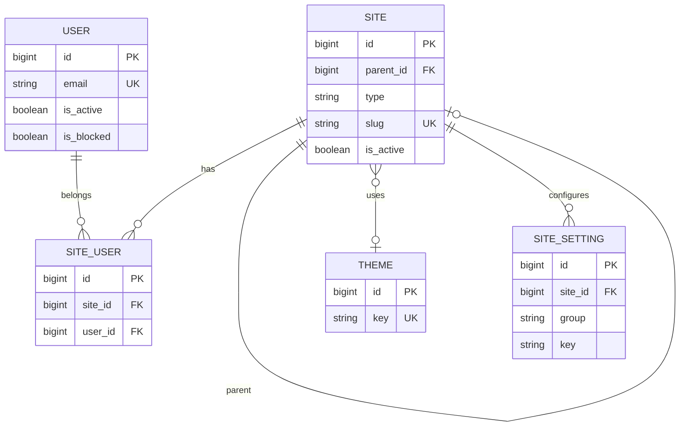
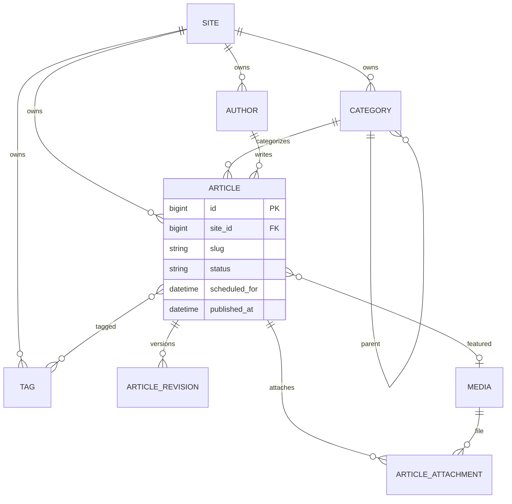
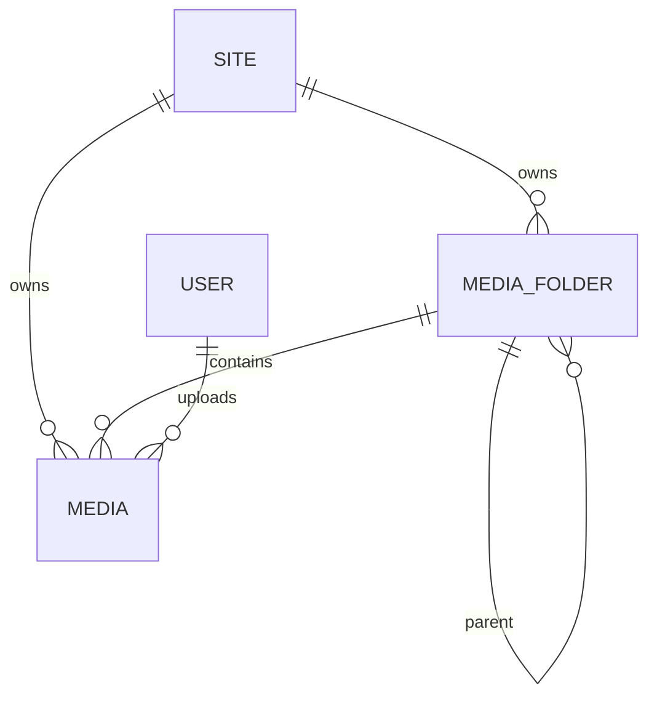
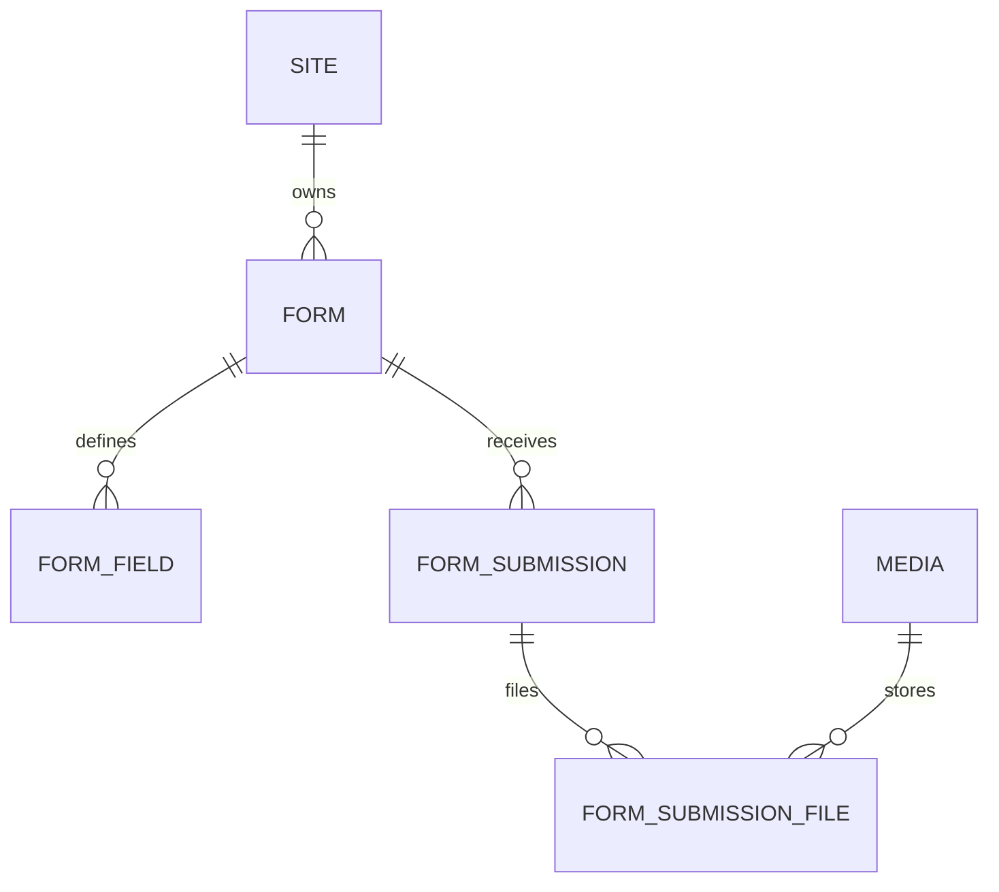
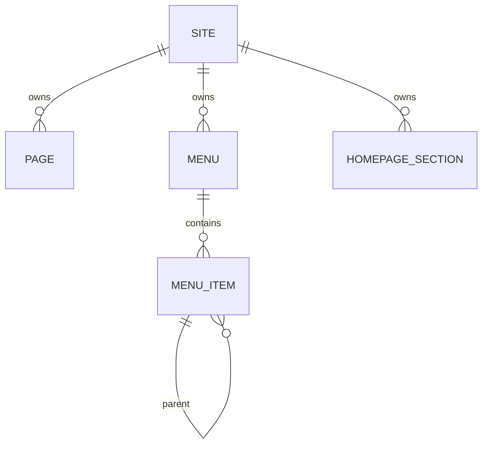
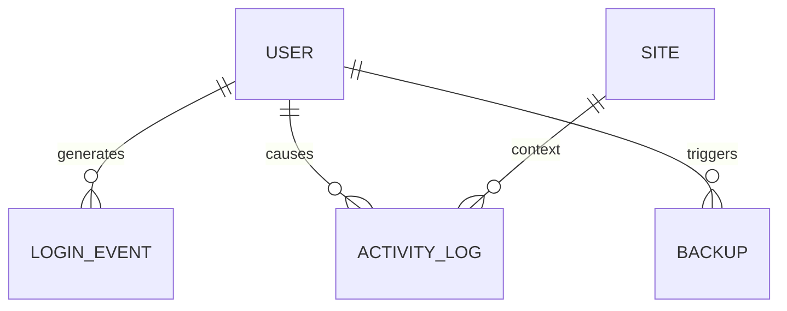

# 05 — Database ERD

Mermaid diagrams for Stage 1 design review. Source copies also live under `DOCUMENTATION/diagrams/`.

## 1. Core tenancy & identity

## 2. Editorial domain

## 3. Media

## 4. Forms

## 5. Menus / pages / homepage

## 6. Security & ops

## Relationship notes

- **Cardinality:** One site has many articles; one article belongs to exactly one site.
- **Cross-site joins are forbidden** in normal queries; Super Admin reporting services may aggregate with explicit authorization.
- **Permission teams:** Spatie `team_id` aligns with `sites.id` (not drawn as custom tables above).
